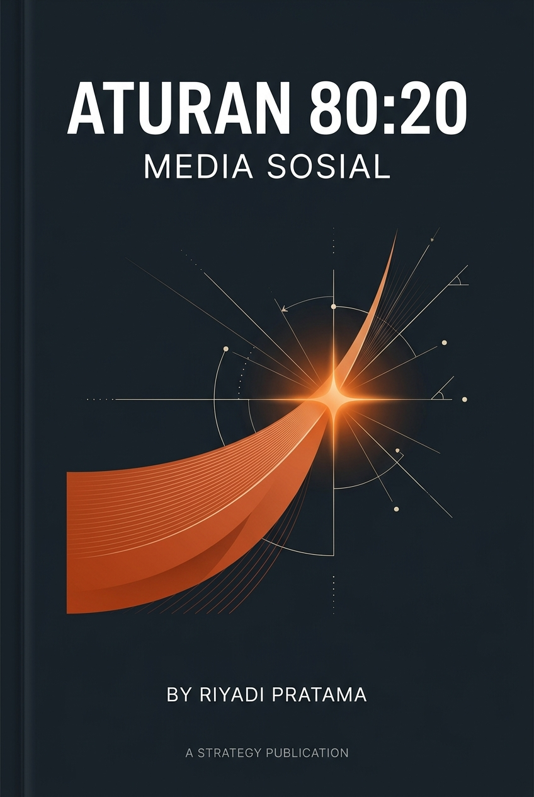
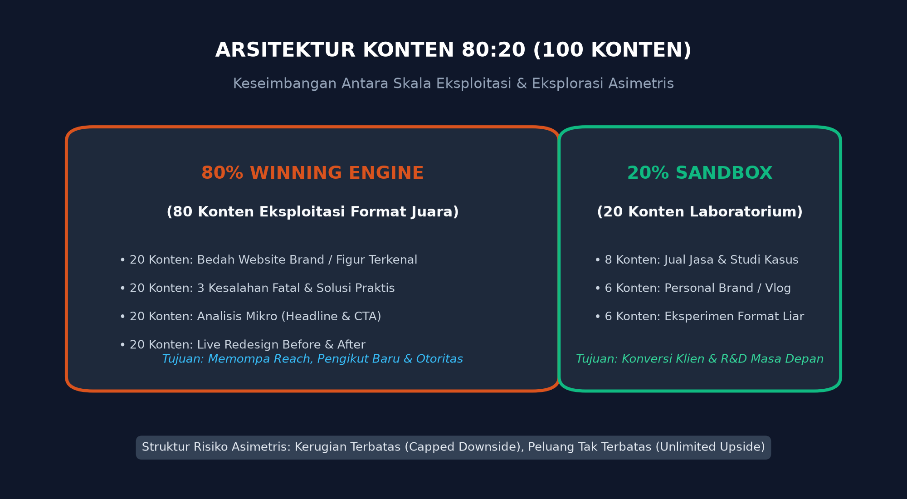
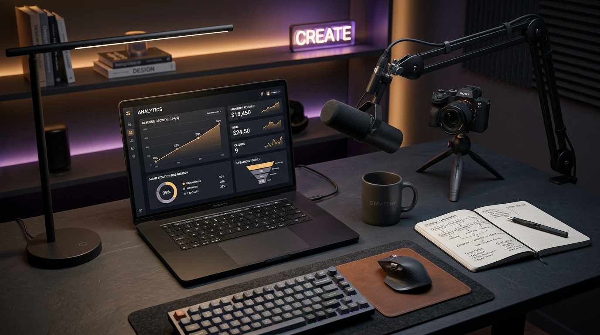
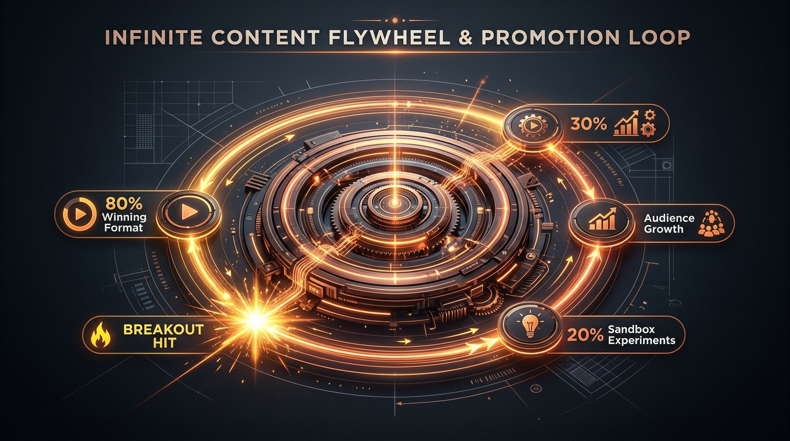
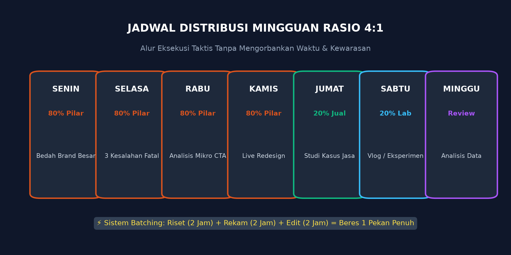
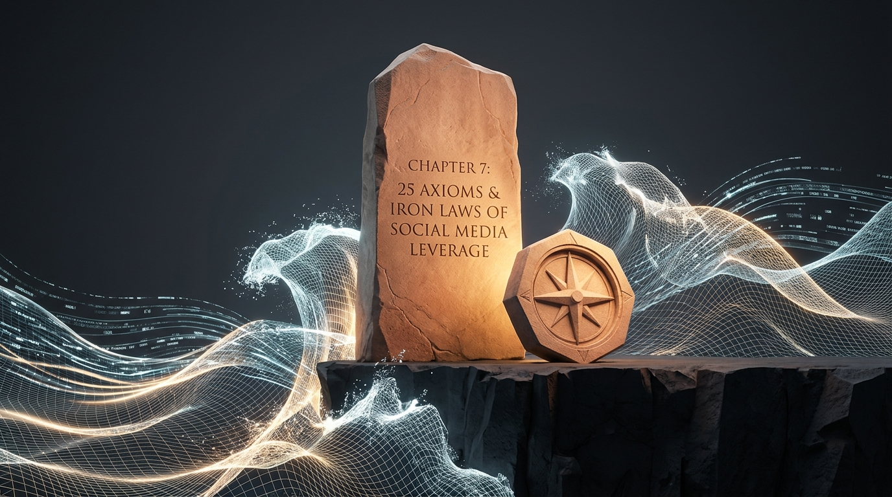

# 📚 Mesin Konten Asimetris: Strategi 80:20 Media Sosial

> **Panduan Taktis Mengembangkan Akun, Membangun Otoritas, dan Memonetisasi Keahlian Tanpa Kehabisan Ide.**  
> *Format Buku Word (.docx) & Web Reader Eksekutif — Lengkap dengan Foto & Ilustrasi untuk Layar iPad & Tablet.*

🌐 **Live Web Reader (Baca Langsung di iPad):**  
👉 **[https://mzaini30.github.io/strategi-media-sosial/](https://mzaini30.github.io/strategi-media-sosial/)**

📥 **Unduh Format Dokumen Lengkap:**
* 📘 [Unduh Format Word (.docx)](buku-strategi-80-20.docx) *(Format Utama: Dilengkapi Ilustrasi Penuh, Cover, & Tipografi iPad 13.5pt)*
* 📕 [Unduh Format PDF (.pdf)](buku-strategi-80-20.pdf) *(Siap impor ke Apple Books / Acrobat)*
* 📖 [Baca Naskah Markdown Lengkap (BUKU-LENGKAP.md)](BUKU-LENGKAP.md)

---

## 🎯 Inti Strategi 80:20

Banyak kreator dan profesional digital gagal bertumbuh bukan karena kekurangan ide, melainkan karena **mengidap sindrom bosan sendiri**: saat satu format konten berhasil meledak, mereka justru meninggalkannya dan mencoba hal acak lainnya.

Buku ini mengajarkan arsitektur konten dua pilar:
- **Pilar 80% (Winning Engine):** Mengeksploitasi format yang sudah terbukti berhasil dengan volume terstruktur. Misalnya jika format "Diskusi dan Bedah Website" terbukti mendatangkan penonton, buat 80 konten berikutnya seputar bedah website dengan 4 variasi sudut pandang taktis.
- **Pilar 20% (Asymmetric Sandbox):** Mengalokasikan 20% ruang untuk menjual jasa/portofolio nyata klien, membagikan vlog personal di balik layar, serta menguji eksperimen format baru yang berpotensi menjadi format pemenang berikutnya.

---

## 🖼️ Galeri Ilustrasi & Diagram Bab

Buku edisi ini dilengkapi dengan ilustrasi konseptual dan diagram infografis resolusi tinggi:

| Bab | Ilustrasi / Diagram | Deskripsi Visual |
| :---: | :--- | :--- |
| **Cover** |  | Desain editorial modern dengan kurva momentum oranye dan latar slate gelap. |
| **Bab 1** |  | *Paradoks Kreator:* Kurva eksponensial pemenang vs garis zig-zag acak kreator yang bosan. |
| **Bab 2** |  | *Arsitektur 80:20:* Matriks pembagian beban antara Winning Engine (80%) dan Sandbox (20%). |
| **Bab 3** |  | *Cetak Biru Bedah Website:* Wireframe 3D pendar pendar analisis elemen konversi. |
| **Bab 4** |  | *Ruang Kerja Studio 20%:* Setup meja kerja creator workstation & penawaran jasa klien. |
| **Bab 5** |  | *Flywheel Konten Abadi:* Mesin sirkular promosi eksperimen menjadi format juara baru. |
| **Bab 6** |  | *Matriks Kalender Mingguan 4:1:* Jadwal harian dan alur kerja batching 6 jam. |
| **Bab 7** |  | *Monolit Prinsip Abadi:* Kompas batu kokoh menghadapi pasang surut algoritma. |

---

## 📖 Daftar Isi Lengkap

| Bab | Judul | Topik Bahasan |
| :---: | :--- | :--- |
| **Bab 1** | [Paradoks Kreator](chapters/01-paradoks-kreator.md) | Jebakan 'konsistensi buta' dan kebiasaan membunuh format pemenang. |
| **Bab 2** | [Prinsip Dasar 80:20](chapters/02-prinsip-dasar-80-20.md) | Algoritma sebagai pengenal pola; eksplorasi vs eksploitasi terukur. |
| **Bab 3** | [Fondasi 80%: The Winning Engine](chapters/03-pilar-80-winning-engine.md) | Bedah studi kasus website: memproduksi 80 variasi konten terstruktur. |
| **Bab 4** | [Laboratorium 20%: Sandbox](chapters/04-pilar-20-asymmetric-sandbox.md) | Cara menjual jasa lewat studi kasus, vlog personal, dan eksperimen liar. |
| **Bab 5** | [Siklus Promosi](chapters/05-the-promotion-loop.md) | Kapan dan bagaimana mempromosikan eksperimen 20% menjadi format 80% baru. |
| **Bab 6** | [Cetak Biru 100 Konten](chapters/06-matematika-konten-100-post.md) | Kalender mingguan 4:1, sistem produksi batching 6 jam per pekan. |
| **Bab 7** | [25 Aksioma & Hukum Besi](chapters/07-25-aforisme-hukum-besi.md) | 25 prinsip ringkas dan tajam tentang pengungkit media digital. |

---

## 📱 Keunggulan Format untuk Pembaca iPad & Tablet

1. **Format Word (.docx):**
   * Menggunakan jenis huruf Georgia dengan ukuran **13.5pt** dan spasi 1.35 yang lapang sehingga nyaman dibaca di aplikasi Microsoft Word / Apple Pages di iPad tanpa perlu memperbesar layar (*zoom*).
   * Dilengkapi halaman sampul eksklusif, daftar isi terstruktur, kotak sorotan (*callout*), serta tabel data berlatar lembut.
2. **Web Reader Interaktif ([index.html](index.html)):**
   * Pengatur ukuran font dinamis (`A+` / `A-`), mode tema (Kertas Terang, Sepia Klasik, Gelap, OLED), dan laci navigasi bab geser.
3. **Dokumen PDF ([buku-strategi-80-20.pdf](buku-strategi-80-20.pdf)):**
   * Dihasilkan dengan tipografi tajam dan seluruh ilustrasi berwarna.

---

## 🚀 Lisensi & Akses
Dibuat untuk para kreator, agensi, dan profesional digital yang ingin membangun pengungkit media tanpa mengorbankan waktu dan kewarasan.
