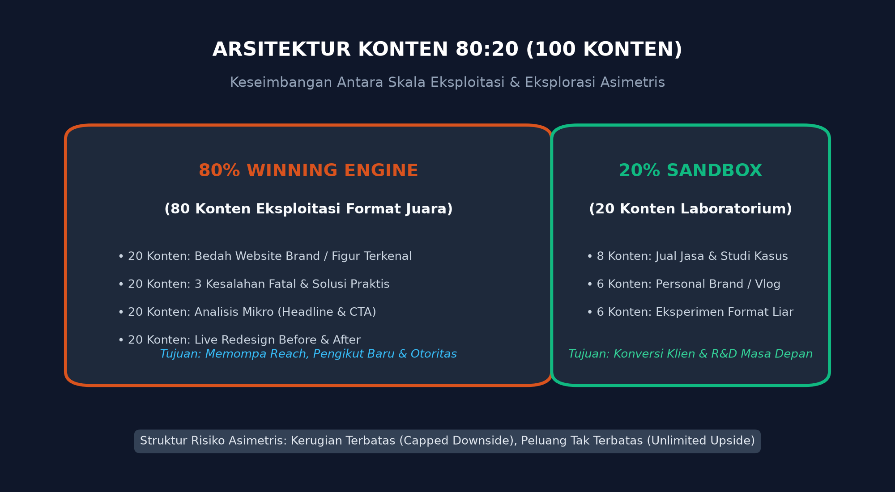

# Bab 2: Prinsip 80:20 — Eksploitasi Format Juara vs Eksplorasi Asimetris
*Arsitektur Distribusi Konten yang Menggabungkan Skala dan Inovasi*

*Diagram 2.1: Arsitektur Konten 80:20 — Pembagian Beban Antara Skala Eksploitasi & Eksplorasi Asimetris*

## Algoritma Adalah Mesin Pengenal Pola

Setiap platform media sosial modern—baik itu TikTok, Instagram, YouTube Shorts, LinkedIn, maupun X—bekerja dengan prinsip yang sama: **mencocokkan konten yang tepat dengan penonton yang tepat demi mempertahankan retensi pengguna.**

Algoritma bukan kurator seni yang mencari keberagaman estetika Anda. Algoritma adalah sistem pemrosesan data statistik:

1. Ketika video Anda tentang topik tertentu mencatatkan waktu tonton (*watch time*) yang tinggi dan interaksi aktif, sistem menandai akun Anda sebagai penyedia konten berkualitas dalam topik tersebut.
2. Jika konten berikutnya menyajikan topik dan format yang serupa, sistem memiliki tingkat kepastian (*confidence score*) yang tinggi untuk kembali mendistribusikannya ke kelompok penonton yang serupa.
3. Sebaliknya, jika Anda melompat dari topik desain website ke tips investasi saham lalu ke vlog kuliner, sistem kebingungan menentukan target audiens Anda, dan penyebaran konten Anda terhenti.

---

## Mengapa Harus 80% vs 20%?

Banyak praktisi terjebak di salah satu dari dua kutub ekstrem:
- **Kutub Kebosanan Total (100% Format Sama Tanpa Variasi):** Akun menjadi kaku, kreator jenuh, tidak ada ruang untuk menjual jasa, dan jika tren format tersebut meredup, akun ikut mati.
- **Kutub Kekacauan Kreatif (100% Eksperimen Acak):** Akun tidak pernah menemukan daya dorong karena tidak ada satu format pun yang didalami hingga matang.

Aturan 80:20 memecahkan kebuntuan ini dengan membagi beban kerja ke dalam dua pilar yang saling mendukung:

| Komponen | Porsi | Peran Utama | Fokus Eksekusi |
| :--- | :---: | :--- | :--- |
| **Winning Engine** | **80%** | Eksploitasi Format Pemenang | Menghasilkan jangkauan luas (*reach*), pengikut baru, dan domain authority. |
| **Asymmetric Sandbox** | **20%** | Eksplorasi & Monetisasi | Menghasilkan penjualan jasa, membangun kedekatan emosional, dan riset format baru. |

---

## Asimetri Risiko dan Peluang

Mengapa porsi eksperimen dibatasi hanya 20%?
Karena ini menciptakan struktur risiko asimetris:
- **Kerugian Terbatas (*Capped Downside*):** Jika sebuah konten eksperimen atau video penawaran jasa gagal mendapatkan penayangan tinggi, performa akun Anda secara keseluruhan tetap aman karena 80% konten lainnya terus memompa jangkauan dan pengikut baru.
- **Peluang Tak Terbatas (*Unlimited Upside*):** Jika satu eksperimen dari porsi 20% ternyata berhasil meledak melebihi format utama, Anda baru saja menemukan formula juara baru yang siap dipromosikan ke pilar 80% di masa depan.

Ini adalah cara kerja investor modal ventura yang diterapkan ke dalam jadwal publikasi media sosial.
