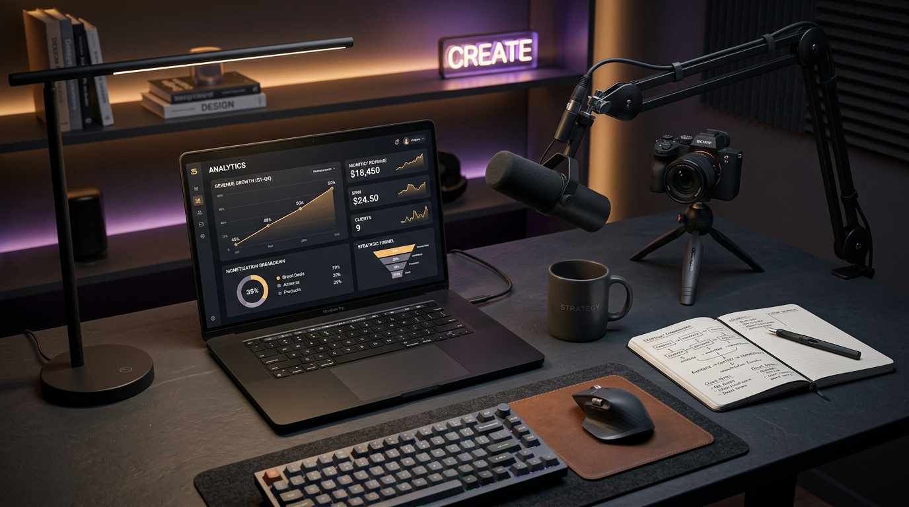

# Bab 4: Laboratorium 20% — Monetisasi Jasa, Portofolio & Eksperimen Liar
*Mengubah Penonton Menjadi Pembeli dan Menemukan Terobosan Format Berikutnya*

*Ilustrasi 4.1: Ruang Kerja Studio 20% — Mengonversi Audiens Menjadi Klien Lewat Bukti Nyata*

## Mengapa 80% Saja Bisa Membunuh Akun Anda?

Jika Anda hanya memposting 100% video bedah website selamanya tanpa pernah melakukan hal lain, dua masalah besar akan muncul:
1. **Audiens melihat Anda sebagai ensiklopedia gratis, bukan sebagai penyedia jasa profesional yang bisa mereka sewa.**
2. **Anda tidak pernah tahu apakah ada format lain yang berpotensi menghasilkan dampak 10 kali lebih besar bagi bisnis Anda.**

Porsi 20% adalah ruang perlindungan dan pertumbuhan strategis akun Anda. Dalam siklus 100 konten, 20 konten ini didistribusikan ke dalam 3 fungsi krusial:
- **8 Konten Penawaran Jasa & Portofolio Klien** (Monetisasi Langsung)
- **6 Konten Personal Brand, Vlog & Filosofi Kerja** (Kedekatan Emosional)
- **6 Konten Eksperimen Format Liar** (R&D Format Masa Depan)

---

## 1. Monetisasi Jasa & Studi Kasus (8 Konten)

Banyak kreator merasa bersalah atau malu saat harus menjual jasa mereka. Mereka merasa penonton akan marah jika disuguhi konten promosi.

Penonton hanya membenci promosi yang buruk: promosi yang memohon-mohon atau promosi yang tidak menawarkan nilai.

Cara terbaik menjual jasa di media sosial adalah **menjual melalui bukti hasil kerja (*results-based selling*)**:

### Formula Konten Penawaran Jasa:
1. **Masalah Nyata Klien:** Ceritakan klien yang datang dengan masalah website yang sepi pembeli meski traffic iklannya tinggi.
2. **Diagnosa Masalah:** Tunjukkan apa yang salah pada website lama mereka (menghubungkannya dengan format 80% yang biasa Anda bahas).
3. **Solusi & Hasil:** Tunjukkan perubahan desain yang Anda lakukan dan kenaikan metrik bisnis yang dicapai klien.
4. **Call to Action (CTA) Jelas:** *"Jika Anda pemilik bisnis dengan traffic di atas 1.000 pengunjung per bulan dan ingin website Anda dikonversi lebih tinggi, kirim pesan 'AUDIT' ke DM saya untuk mendapatkan sesi review gratis selama 15 menit."*

Konten seperti ini tidak terasa seperti iklan yang mengganggu; konten ini terasa seperti pelajaran berharga yang diakhiri dengan solusi bagi mereka yang membutuhkan.

---

## 2. Personal Brand, Vlog & Filosofi Kerja (6 Konten)

Orang bertransaksi dengan manusia, bukan dengan logo perusahaan atau akun tanpa wajah.

Gunakan 6 konten ini untuk membagikan:
- **Di Balik Layar Kerja:** Bagaimana setup meja kerja Anda, software yang Anda gunakan, dan alur kerja harian Anda dalam menyelesaikan proyek klien.
- **Pelajaran dari Kegagalan:** Cerita tentang kesalahan terbesar yang pernah Anda buat di masa lalu dan apa yang Anda pelajari darinya.
- **Prinsip Kerja:** Mengapa Anda menolak jenis proyek tertentu demi menjaga kualitas hasil kerja.

Konten ini membangun kepercayaan emosional mendalam (*deep trust*) yang tidak bisa ditiru oleh kompetitor.

---

## 3. Eksperimen Format Liar (6 Konten)

Gunakan 6 konten ini untuk mencoba format yang sama sekali baru:
- Mencoba format podcast monolog 3 menit dengan mikrofon klasik.
- Membuat konten karosel infografis visual beresolusi tinggi.
- Wawancara singkat dengan pemilik bisnis offline tentang tantangan digital mereka.

Sebagian besar eksperimen ini mungkin menghasilkan performa biasa saja. Tetapi jika salah satunya mencatatkan lonjakan metrik di luar dugaan, Anda baru saja menemukan calon format juara berikutnya.
