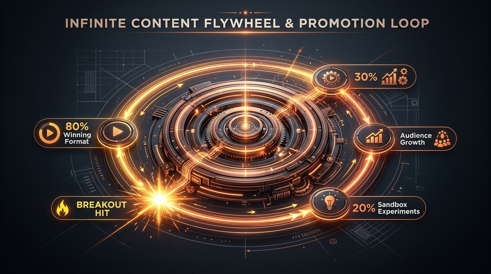

# Bab 5: Siklus Promosi — Mengubah Eksperimen 20% Menjadi Format Juara Baru
*Membangun Mesin Pertumbuhan Konten yang Tidak Pernah Usang*

*Ilustrasi 5.1: Flywheel Regenerasi Konten — Siklus Promosi Eksperimen Menjadi Format Juara Baru*

## Kurva Kejenuhan Konten (*Content Decay Curve*)

Tidak ada format konten yang bisa bertahan selamanya dengan performa puncak.

Bahkan format bedah website terbaik pada akhirnya akan mengalami penurunan efektivitas setelah 6 hingga 12 bulan. Penonton lama sudah terbiasa dengan gaya penyampaian Anda, dan algoritma mulai menuntut variasi baru untuk mempertahankan durasi tonton pengguna.

Kreator amatir panik ketika format andalan mereka mulai melambat. Mereka merasa algoritma sedang menghukum mereka.

Kreator profesional menyikapi ini dengan tenang karena mereka telah menjalankan porsi 20% secara konsisten sejak hari pertama.

---

## Protokol Promosi Format Konten

Kapan sebuah konten dari laboratorium 20% berhak dipromosikan menjadi pilar 80% yang baru?

Gunakan checklist metrik evaluasi objektif berikut:

1. **Metrik Retensi:** Apakah video eksperimen tersebut memiliki rasio penyelesaian (*completion rate*) di atas 60% pada 30 detik pertama?
2. **Metrik Pembagian (*Share Ratio*):** Apakah rasio pembagian konten terhadap penayangan mencapai minimal 2-3%? (Tanda bahwa konten tersebut memiliki nilai sosial tinggi).
3. **Pengikut Baru per Penayangan:** Apakah eksperimen tersebut menghasilkan laju konversi pengikut baru yang setara atau lebih tinggi dibandingkan format 80% yang sedang berjalan?

---

## Contoh Transisi Mulus

Katakanlah dari 6 eksperimen liar di porsi 20%, Anda mencoba format: **"Wawancara Pemilik Bisnis & Bedah Finansial Website Mereka."**

Format ini ternyata mendapatkan antusiasme luar biasa. Banyak pemilik bisnis lain yang berkomentar ingin diwawancarai.

Langkah strategis Anda pada siklus 100 konten berikutnya:
- **Format 80% Baru:** Wawancara Pemilik Bisnis & Bedah Finansial Website (kini mengambil porsi utama).
- **Format 20% Baru:** Bedah website versi cepat (yang sebelumnya 80%), penawaran jasa, dan vlog kehidupan.

Dengan cara ini, akun Anda berevolusi secara organik mengikuti data pasar riil, bukan berdasarkan tebakan emosional.
