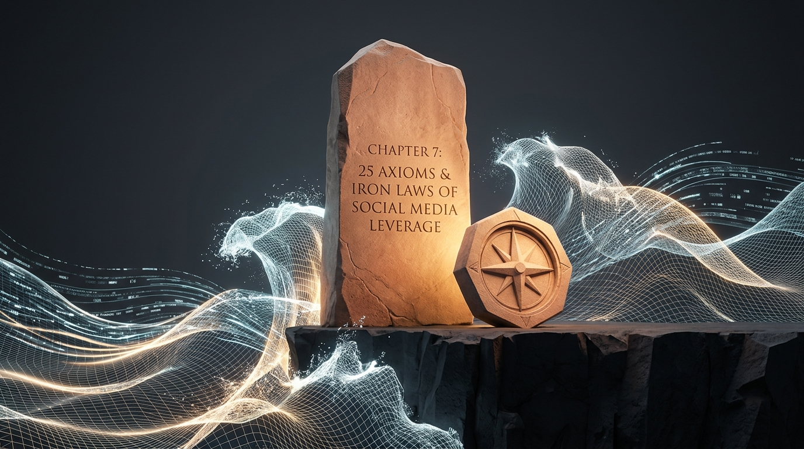

# Bab 7: 25 Aksioma & Hukum Besi Media Sosial
*Prinsip-Prinsip Pokok Pengungkit Digital untuk Dibaca Berulang Kali*

*Ilustrasi 7.1: Monolit Prinsip Digital Abadi — Bertahan Menghadapi Pasang Surut Algoritma*

## Kumpulan Prinsip Aksiomatik Pertumbuhan Digital

Simpan halaman ini. Buka kembali saat Anda merasa kehilangan arah atau tergoda untuk berhenti memposting format yang sedang bekerja.

1. **Pasar tidak berhutang apa pun pada usaha Anda.** Pasar hanya merespons nilai nyata yang relevan bagi mereka.
2. **Kebosanan kreator adalah pembunuh momentum nomor satu.** Jangan membunuh format yang disukai penonton hanya karena Anda bosan membuatnya.
3. **Media adalah mesin pengganda tanpa izin.** Satu konten berkualitas dapat berbicara kepada ribuan orang sekaligus saat Anda tertidur lelap.
4. **Algoritma adalah cermin dari penonton.** Jika konten Anda tidak didistribusikan, jangan salahkan platform; perbaiki hook dan nilai konten Anda.
5. **Konsistensi tanpa arah hanyalah kesia-siaan yang disiplin.** Lebih baik memposting 3 konten terarah per minggu daripada 14 konten acak tanpa tujuan.
6. **Eksploitasi 80% membangun kerajaan jangkauan Anda.** Ini adalah mesin yang mendatangkan orang-orang baru setiap detik.
7. **Eksplorasi 20% melindungi masa depan kerajaan tersebut.** Ini adalah laboratorium yang memastikan Anda tidak punah saat tren bergeser.
8. **Jual hasil, bukan proses kerja yang rumit.** Klien tidak membeli baris kode atau desain website; mereka membeli peningkatan kepercayaan dan omzet bisnis.
9. **Spesialisasi mengalahkan generalisasi di fase awal.** Menjadi orang nomor satu di bidang "Bedah Website UMKM" jauh lebih menguntungkan daripada menjadi "Kreator Konten Digital Serbabisa".
10. **Tiga detik pertama adalah gerbang penentu.** Jika Anda gagal meyakinkan penonton dalam 3 detik pertama, 57 detik berikutnya tidak pernah ada di mata mereka.
11. **Bukti visual membungkam segala keraguan.** Menunjukkan perbaikan desain sebelum dan sesudah jauh lebih meyakinkan daripada menulis esai 1.000 kata tentang teori desain.
12. **Ubah subjeknya, pertahankan struktur pemenangnya.** Jika format bedah website berhasil, bedah 80 website berbeda dengan struktur yang sama.
13. **Konversi membutuhkan instruksi yang gamblang.** Jangan berasumsi penonton tahu cara menyewa jasa Anda; beri tahu mereka dengan tepat langkah apa yang harus diambil.
14. **Retensi adalah metrik kebenaran.** Jumlah klik bisa dipancing dengan judul sensasional, tapi waktu tonton hanya bisa diraih dengan substansi yang solid.
15. **Akun yang tidak pernah menjual jasa adalah hobi yang mahal.** Jangan takut menawarkan keahlian Anda kepada mereka yang membutuhkan solusi nyata.
16. **Emosi menghubungkan, data meyakinkan.** Gunakan cerita personal di porsi 20% untuk membangun kedekatan emosional, dan gunakan data di porsi 80% untuk membangun otoritas.
17. **Kerugian Anda di porsi 20% selalu terbatas, tapi potensi keuntungannya tidak terbatas.** Ini adalah definisi taruhan asimetris terbaik.
18. **Format yang lelah bukan akhir dari segalanya.** Format lama melambat agar format baru yang telah Anda uji di laboratorium bisa naik panggung utama.
19. **Jangan menunggu inspirasi datang untuk mulai merekam.** Inspirasi adalah hasil sampingan dari proses kerja yang terstruktur, bukan syarat awalnya.
20. **Audiens baru tidak membaca arsip masa lalu Anda.** Hal yang terasa berulang bagi Anda adalah wawasan segar bagi orang yang baru saja mengikuti akun Anda hari ini.
21. **Kemudahan konsumsi menentukan laju distribusi.** Buat ide yang rumit menjadi analogi visual yang bisa dipahami dalam waktu kurang dari satu menit.
22. **Kritik dari orang yang tidak pernah memproduksi apa pun bernilai nol.** Dengarkan data perilaku penonton, abaikan komentar negatif tanpa substansi.
23. **Skalakan apa yang berhasil sampai batas maksimal.** Sebelum Anda mencoba strategi baru, pastikan strategi lama sudah diperas seluruh potensinya.
24. **Kepercayaan membutuhkan waktu berbulan-bulan untuk dibangun, tapi hanya butuh satu kebohongan untuk hancur.** Selalu tulus dalam memberikan rekomendasi dan penilaian.
25. **Mainkan permainan jangka panjang dengan orang-orang jangka panjang.** Bangun reputasi digital Anda di atas dasar keahlian yang nyata dan nilai yang terbukti.
